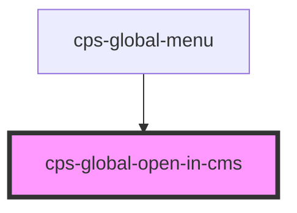

# cps-global-open-in-cms

<!-- Auto Generated Below -->

## Overview

"Open in…" dropdown offering CMS Classic and CMS Modern. The look follows the UCD
prototype's CMS Classic dropdown; the behaviour does not, because the prototype's
is mouse-only.

WHY A DISCLOSURE, NOT role="menu": the ARIA menu pattern promises application-style
keyboard handling (roving focus, typeahead) and takes the options out of the Tab
order. A disclosure button that reveals ordinary buttons is what W3C recommends for
site navigation, and it works with plain Tab as well as with the arrow keys we add.

Closed means `hidden`, so assistive tech and the Tab order see what the eye sees.

## Properties

| Property | Attribute | Description | Type     | Default     |
| -------- | --------- | ----------- | -------- | ----------- |
| `caseId` | `case-id` |             | `number` | `undefined` |

## Dependencies

### Used by

 - [cps-global-menu](../cps-global-menu)

### Graph

----------------------------------------------

*Built with [StencilJS](https://stenciljs.com/)*
